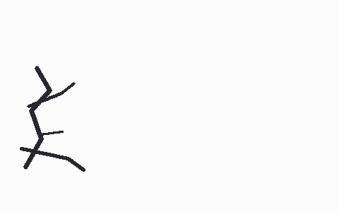
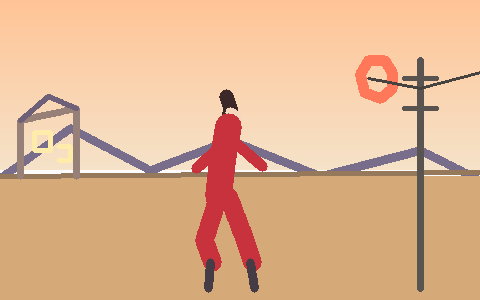

# 动画 AI 协作绘画编辑器（Anime Collab Painter）

仓库：https://github.com/MrGendo/anime-collab-painter
公网演示：https://feat-actively-testament-occupations.trycloudflare.com

动画创作工作室风格的 Web 应用，演示「**人工主导、AI 辅助、用户确认**」的人机协作绘画闭环：

    创建画布 → 人工绘制 → AI 评估 → 反馈建议（接受/拒绝/调整）→ 生成修正版 → 并排对比 → 采纳 → 下一轮迭代

不是「画布 + 聊天框」：AI 的每条建议都绑定具体问题、实测数字、修改区域（region）和修改范围（scope）；AI 永不直接改画布，只有用户点「采纳」才会把修正版画上并自动存快照、Round+1。

## 评估是真实的：同一评估器，好画高分、差画低分

项目支持两套评分引擎（`/api/config` 实时可见当前模式）：**规则引擎**（像素度量+公式，无 Key 默认）与**真实多模态大模型**（glm-4.5v，看图后给出分数与建议）。同一组画布在两套引擎下的实测分数：

| 画布 | 规则引擎（像素度量） | 真实模型 glm-4.5v（看图评分） |
|---|---|---|
| 差：左下角随手涂鸦 | 16 / 100 | **18 / 100** |
| 坏招：单色平涂整幅 | 54 / 100 | **5 / 100**（"完全缺失角色结构与场景要素，需根本性重建"） |
| 好：黄昏小巷完整构图 | 96 / 100 | **25 / 100**（"抽象色块堆叠阶段：红衣仅占 3.8%、边缘密度 0.0153，角色设定不可辨认"） |

两套引擎对**好坏排序一致**（完整构图 > 角落涂鸦），但尺度不同：规则引擎度量的是**结构指标**（覆盖率/质心/色数/边缘密度的公式合成，mock.ts 注释公开）；真实模型按**画面完成度与角色可辨识度**评价——它真的在"看"：能指出红色只占 3.8%、双马尾没画、回眸姿态缺失，并给出针对性 fix（"红色占比扩到 25% 以上、上 1/3 天空下 1/3 地面分层"）。平涂在真实模型眼里比涂鸦更糟（5 < 18）：涂鸦至少算起稿，平涂连起稿都不是。

| 差画（两引擎：16 / 18 分） | 好图（96 / 25 分——模型按完成度严评） |
|---|---|
|  |  |

真实模式配置（密钥只走服务端环境变量）：

```bash
export AI_PROVIDER=real
export LLM_API_KEY=... LLM_MODEL=glm-4.5v
export LLM_BASE_URL=https://open.bigmodel.cn/api/anthropic   # GLM coding plan 额度端点（Anthropic 协议，自动探测）
# export IMG_API_KEY=...                                     # 可选；不设则图像生成回落 Mock 并在 note 如实标注
export REQUEST_TIMEOUT_MS=180000                              # 多模态评估常需 60s+，默认 60s 可调大
```

评分复现脚本：`node scripts/eval_demo_canvases.mjs`（规则引擎）与 `node scripts/eval_real_all.mjs`（真实模型，需先配 env）。低分不是随口给的——每条问题都引用实测数字（如「覆盖率 1.4%，AI 无法在空白画布上做构图评估」）。

## 在线体验

公网演示（Mock 演示模式，无需任何 API Key）：

    https://feat-actively-testament-occupations.trycloudflare.com

30 秒体验路径：
1. 首页填「主题/角色设定/画面目标」创建项目
2. 左侧选画笔，在画布左侧画几笔（故意画偏一点，AI 才有话可说）
3. 右侧「请求 AI 评估」→ 查看带实测数字的建议（如"内容 100% 挤在左侧 1/3，质心 x=0.151"）
4. 对建议点「接受」→ 下方生成区出现待生成项；可先编辑 Prompt（编辑后才是发送内容）
5. 「生成修正版」→ 对比弹层左右并排原画布 vs 修正版 → 「采纳」→ Round+1、历史条新增快照
6. 底部历史条点缩略图可预览/恢复任意快照（恢复前当前画面自动另存，历史永不丢）
7. 想看失败路径：勾选「模拟生成失败」再点生成 → 错误提示 + 重试按钮

## 本地运行

```bash
# 后端（端口 8903，托管前端产物）
cd server && npm install && npm run build && npm start

# 前端（开发模式，另开终端；或直接用上面的服务端托管产物）
cd web && npm install && npm run dev   # http://localhost:8904

# 测试
cd server && npm test                  # 36/36（analyzer/mock/mockgen/API/real stub）
```

## AI Provider：Mock 与真实模型

统一 `AIProvider` 接口（`server/src/ai/`），默认 Mock、可切真实模型：

- **Mock（默认）**：不是固定文案。`analyzer.ts` 用 pngjs 对画布做真实像素度量（覆盖率、3x3 网格、质心、调色板 Top6、边缘密度、上下三分之一占用），`mock.ts` 按阶段感知规则表把度量变成具体问题+建议（每条引用实测数字），`mockgen.ts` 按 scope 做真实像素变换（pose=平移剪切 / contour=线条膨胀 / color=色相旋转 / background=渐变+剪影填充 / local=仅 region 内），输出带 `MOCK·scope修正` 半透明水印，确定性可复现。
- **真实模型**：`AI_PROVIDER=real` + 环境变量即可（OpenAI 兼容协议）：

```bash
export AI_PROVIDER=real
export LLM_API_KEY=... LLM_BASE_URL=... LLM_MODEL=...        # 多模态评估（画布图+目标→结构化 JSON）
export IMG_API_KEY=... IMG_BASE_URL=... IMG_MODEL=...         # 图像生成（images/edits 或 generations）
export IMG_EDIT_MODE=edits                                     # 可选：优先图生图/局部重绘；缺省走文生图并在 note 声明不保证保留原图
```

密钥只从服务端环境变量读取，前端仅通过 `GET /api/config` 看到 `mode/hasLlmKey` 等布尔信息，永不回传 key。真实 provider 的超时/坏 JSON/401 处理均有 fetch stub 单测覆盖。

## 阶段驱动的 Prompt 模板

创作阶段（草稿→线稿→上色→细化）× 任务类型（构图评估/角色一致性/姿态纠正/轮廓/色彩/背景/局部修改/风格统一）组合出 8 个服务端模板（`server/src/prompts.ts`）。生成任务的 prompt 必须包含：用户目标、角色设定、建议的 fix、实测数字与 scope 限定语（例：仅调整姿态，保持轮廓配色背景不变）。前端「套用服务端模板」可预览 `/api/prompt/build` 的拼装结果并继续编辑。

## 架构

```
web/    React 18 + TS + Vite（无 UI 库，自建设计系统）
        canvas/engine.ts    960x600 双层画布（点阵网格 overlay 不进导出）、画笔/橡皮、撤销栈 40
        ai/AIPanel.tsx      评估四态 / 建议决策 / 生成对比 / 采纳闭环
        history/HistoryBar  快照缩略图 + 轮次时间线 + 恢复（恢复前自动另存）
server/ Node 24 + Express + TS（依赖仅 express/cors/pngjs）
        ai/analyzer.ts      像素度量（评估与 Mock 生成的数据基础）
        ai/mock.ts|mockgen  确定性 Mock：规则表 + 真实像素变换
        ai/real.ts          OpenAI 兼容真实 provider（chat 多模态 + images edits/generations）
        prompts.ts          阶段×任务模板注册表
        store.ts            projects.json 原子持久化（tmp+rename、快照上限 30）
docs/   运行截图（工作台 / 评估建议 / 对比采纳）
```

关键 API：`POST /api/evaluate`（画布图+目标+阶段→结构化 JSON）、`POST /api/prompt/build`（模板特调）、`POST /api/generate`（可 `simulateFail:true` 演示失败路径）、`GET/PUT /api/projects/:id`（rev 递增）。详见 `design.md` §3。

## 交付说明

- 详细报告（实现方式/交互设计考量/AI 工具与 token 消耗/人工投入）见 `REPORT.md`
- 工程契约与波次任务书见 `design.md` 与 `TASKS/`
- 已知边界：Mock 生成是确定性像素变换（非扩散模型）；真实模式未经真实 key 实测（有 stub 测试）；快照上限 30 条全幅。
